  

<h2 align="center">Hola, soy Sebastián Hernández 👋</h2>

  <em>Full Stack Developer · Backend con PHP y Laravel</em>

  

---

### 💻 Lenguajes de programación

  

### 🌐 Backend y desarrollo web

  

### 🗄️ Bases de datos

  

### 🛠️ Herramientas y entornos

  

### 🧰 Otras herramientas

  
  
  
  
  
  
  

---

<h3 align="center">📊 Estadísticas de GitHub</h3>

  
  

  

 

<h3 align="center">🐍 Actividad en GitHub</h3>

  <picture>
    <source media="(prefers-color-scheme: dark)" srcset="https://raw.githubusercontent.com/SebasHernandezG/SebashernandezG/output/snake-dark.svg" />
    <source media="(prefers-color-scheme: light)" srcset="https://raw.githubusercontent.com/SebasHernandezG/SebashernandezG/output/snake.svg" />
    
  </picture>

 

  <em>"Escribo código para que se entienda, lo estructuro para que escale y lo mejoro hasta que dure."</em>

