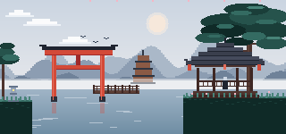

<h2 align="center">Hola, soy Sebastián Hernández</h2>

  

 

### Contáctame en

&nbsp;&nbsp;&nbsp;

&nbsp;&nbsp;&nbsp;

  

### Lenguajes de programación

  

### Backend y desarrollo web

  

### Bases de datos

  

### Herramientas y entornos

  

### Otras herramientas
 

 

  

